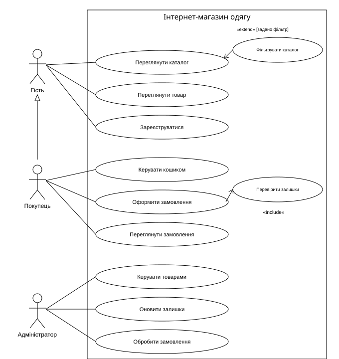
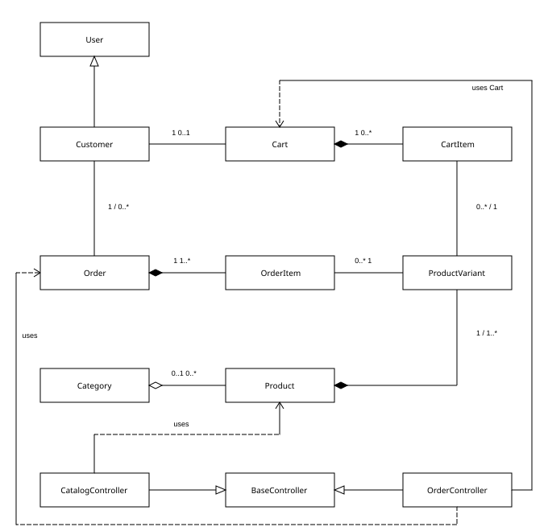
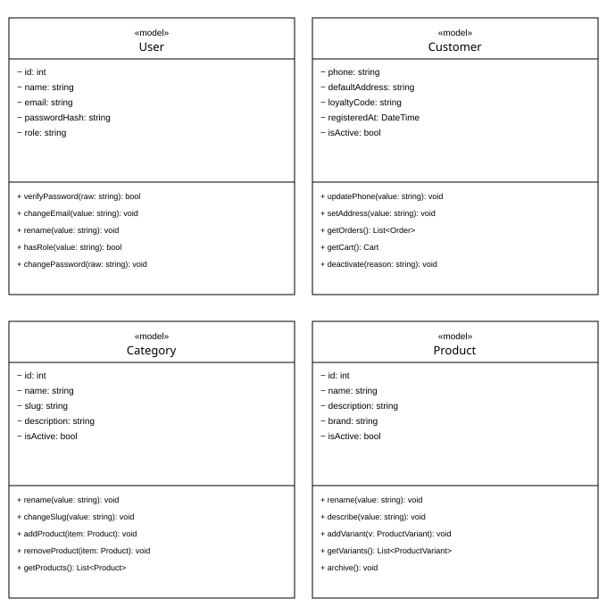
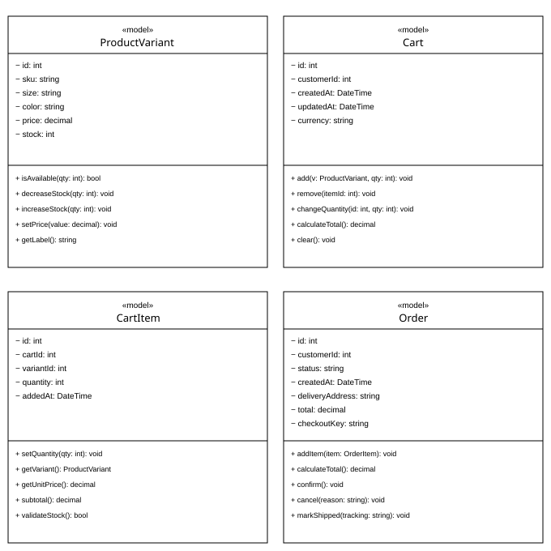
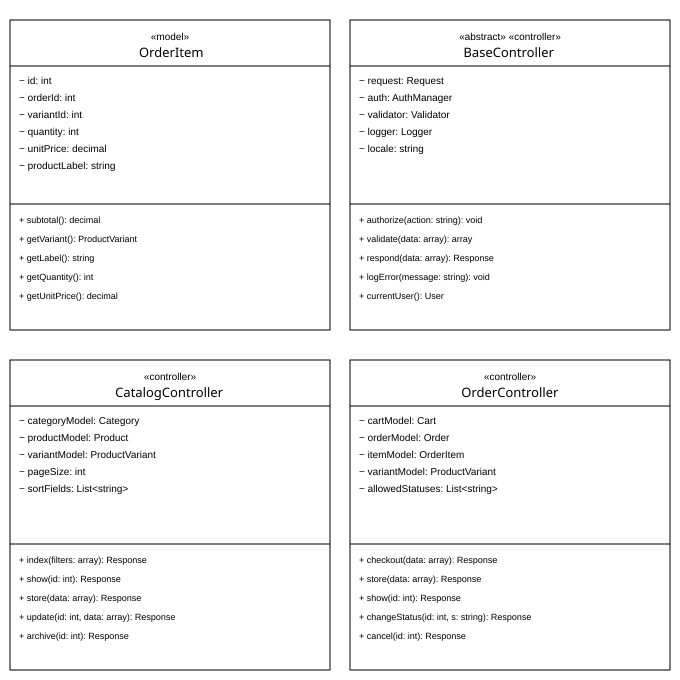

# Інтернет-магазин одягу

## 1. Мета та аналіз предметної галузі

**Мета роботи.** Проаналізувати предметну галузь інтернет-магазину одягу, визначити функціональні вимоги, описати варіанти використання та побудувати UML-моделі як основу для подальшої реалізації веб-додатка на PHP/Laravel.

**Завдання.** Визначити користувачів, функції, сценарії, сутності й таблиці БД; описати три Use Cases у різних формах; побудувати діаграми варіантів використання та класів; підготувати документацію для репозиторію.

### 1.1 Призначення та межі системи

Система автоматизує вибір і замовлення одягу. Одиницею продажу є конкретний варіант товару (SKU), визначений моделлю, розміром і кольором. Для кожного SKU зберігаються ціна та залишок. Покупець формує кошик, зазначає адресу та отримує підтвердження замовлення; адміністратор підтримує каталог і обробляє замовлення.

Для навчальної моделі прийнято оплату при отриманні, одну валюту UAH та ручне внесення адміністратором даних відправлення. Банківські платежі, інтеграції перевізників, повернення та промокоди перебувають поза межами цієї версії. Оформлення доступне після входу до облікового запису.

### 1.2 Користувачі системи

Гість: переглядає каталог, відкриває картку товару, реєструється. Покупець: успадковує можливості гостя, керує кошиком, оформлює та переглядає власні замовлення. Адміністратор: керує товарами, залишками та статусами замовлень.

### 1.3 Основні функції

1. Пошук і фільтрація одягу за категорією, розміром, кольором та ціною.
2. Перегляд опису товару, доступних варіантів і залишків.
3. Реєстрація, вхід та розмежування доступу за ролями.
4. Додавання SKU до кошика, зміна кількості та видалення позицій.
5. Оформлення замовлення з перевіркою залишків і фіксацією цін.
6. Перегляд історії та стану власних замовлень.
7. Створення й редагування товарів, категорій та варіантів.
8. Оновлення залишків і супровід замовлення до відправлення.

## 2. Архітектура та структура даних

**Model.** Моделі User, Customer, Category, Product, ProductVariant, Cart, CartItem, Order, OrderItem зберігають стан і правила предметної галузі. Customer є спеціалізацією User в об’єктній моделі; дані обох класів зберігаються в users з ознакою role, без окремої таблиці customers.

**View.** Сторінки каталогу, картки товару, кошика, оформлення, історії та адміністративної панелі подають дані користувачу. Подання не змінюють залишки й не визначають підсумкові ціни.

**Controller.** CatalogController обробляє запити каталогу, OrderController — оформлення та обробку замовлень. Спільні перевірки доступу, валідації та відповіді описані абстрактним BaseController. Це проєктні класи, а не перелік готових API фреймворку.

### 2.1 Основні таблиці БД

users — id PK, name, email UNIQUE, password_hash, role, phone, default_address, loyalty_code, registered_at, is_active.

categories — id PK, name, slug UNIQUE, description, is_active.

products — id PK, category_id FK NULL, name, description, brand, is_active.

product_variants — id PK, product_id FK, sku UNIQUE, size, color, price DECIMAL, stock INTEGER.

carts — id PK, customer_id FK UNIQUE, currency, created_at, updated_at.

cart_items — id PK, cart_id FK, variant_id FK, quantity, added_at; UNIQUE(cart_id, variant_id).

orders — id PK, customer_id FK, status, recipient_name, recipient_phone, delivery_address, total DECIMAL, checkout_key UNIQUE, tracking_number NULL, created_at.

order_items — id PK, order_id FK, variant_id FK, quantity, unit_price DECIMAL, product_label.

### 2.2 Правила цілісності та вихідні дані

Кількість у позиції додатна, залишок і ціна невід’ємні. Остаточна сума дорівнює сумі quantity × unit_price. Замовлення зберігає знімок назви SKU, ціни та адреси. Історичні товари архівуються, щоб не порушувати посилання з order_items. Створення замовлення, списання залишків і очищення кошика виконуються атомарно.

Вихідні дані: (1) каталог із цінами та наявністю; (2) підтвердження замовлення з позиціями й сумою; (3) таблиця історії замовлень зі статусами; (4) адміністративна таблиця складських залишків. Це проєктовані подання, а не результати роботи реалізованої системи.

## 3. Варіанти використання

### 3.1 UC01. Знайти одяг у каталозі — коротка форма

Гість відкриває каталог, задає категорію, розмір, колір та діапазон цін. Система показує товари з відповідними варіантами. Гість відкриває картку обраного товару й переглядає опис, ціну та наявність потрібного SKU. Мета досягнута, коли користувач отримав інформацію для вибору одягу.

### 3.2 UC02. Оновити залишок SKU — поверхнева форма

Головний актор: адміністратор. Мета: відобразити фактичну доступність варіанта товару. Передумова: адміністратор увійшов до системи та має право редагувати складські дані.

1. Адміністратор відкриває таблицю залишків і знаходить SKU.
2. Система показує назву, розмір, колір і поточний залишок.
3. Адміністратор вводить нову кількість і підтверджує зміну.
4. Система перевіряє права та допустимість кількості.
5. Система зберігає залишок і відображає оновлені дані.

Альтернативи. SKU не знайдено — адміністратор змінює критерії пошуку. Введено від’ємне або неціле число — система показує помилку без збереження. Паралельно залишок змінено іншим запитом — система пропонує перечитати дані. Доступ відкликано — операцію відхилено.

Результат: новий залишок доступний у каталозі; за помилки попередні дані зберігаються.

### 3.3 UC03. Оформити замовлення — повна форма

Scope: System — веб-система інтернет-магазину одягу. Level: User-goal. Primary Actor: покупець. Тригер: натискання кнопки «Оформити замовлення» у кошику.

Stakeholders and interests: покупець очікує правильних розмірів, кольорів і суми; адміністратор потребує повних контактних даних; власник магазину зацікавлений у достовірному обліку замовлень і відсутності продажу понад залишок.

Preconditions: покупець автентифікований, обліковий запис активний, кошик містить хоча б одну позицію. Наявність товару перевіряється повторно під час оформлення, а не вважається гарантованою передумовою.

## 4. UC03. Основний успішний сценарій

Success guarantee: створено одне замовлення з унікальним номером, знімками позицій, адресою та сумою; залишки зменшено; кошик очищено; покупцю доступне підтвердження. Мінімальна гарантія: за невдачі транзакції немає часткового замовлення або часткового списання.

1. Покупець переходить із кошика до оформлення замовлення.
2. Система перевіряє сесію, права покупця та непорожній кошик.
3. Система завантажує позиції з актуальними цінами й доступністю SKU.
4. Покупець перевіряє склад замовлення та кількість одиниць.
5. Покупець вводить ім’я одержувача, телефон та адресу доставки.
6. Система перевіряє заповнення й формат контактних даних.
7. Система показує підсумок товарів, адресу та спосіб оплати «При отриманні»; вартість доставки сплачується перевізнику окремо.
8. Покупець підтверджує оформлення; запит містить унікальний checkoutKey.
9. Система починає транзакцію й блокує записи кошика та відповідних SKU.
10. Система повторно перевіряє залишки й ціни, а також відсутність замовлення з таким checkoutKey.
11. Система створює Order зі статусом «Нове» та OrderItem зі знімками назв, кількостей і цін.
12. Система зменшує залишки SKU та очищує кошик у тій самій транзакції.
13. Система фіксує транзакцію та повертає номер, склад і суму замовлення.
14. Покупець відкриває сторінку замовлення й бачить його поточний статус.

### 4.1 Життєвий цикл замовлення

Нове → Підтверджене → Відправлене → Завершене. До відправлення можливий перехід у стан «Скасоване» з одноразовим поверненням залишків. Адміністратор підтверджує й відправляє замовлення; покупець переглядає стан. Повторне скасування не збільшує залишки вдруге.

## 5. UC03. Альтернативи та спеціальні вимоги

2a Сесію завершено. Система пропонує вхід, зберігає кошик і після автентифікації повертає до кроку 2.

2b Кошик порожній. Система припиняє оформлення й відкриває каталог; замовлення не створюється.

6a Некоректні контакти. Поля з помилками позначаються, введені значення зберігаються; покупець виправляє дані, повторюється крок 6.

10a Недостатній залишок. Транзакція відкочується. Система показує доступну кількість; покупець редагує кошик і повертається до кроку 3.

10b Ціна змінилася. Транзакція відкочується. Система показує нову суму й вимагає повторного підтвердження з кроку 7; автоматична купівля за іншою ціною не відбувається.

10c Повторний запит. Якщо замовлення з checkoutKey вже існує для цього покупця, система повертає його номер без повторного списання. Унікальне обмеження захищає і від одночасних повторів.

11–13a Помилка БД. Незафіксовані зміни відкочуються. Якщо відповідь втрачено після фіксації, повторний запит з тим самим ключем повертає вже створене замовлення.

8a Покупець відмовився. До підтвердження він повертається до кошика; залишки не змінюються.

### 5.1 Додаткові параметри повного Use Case

Special Requirements. Сервер перевіряє права, контакти, кількості та суми. Клієнтська ціна не є довіреною. Власні замовлення доступні лише їх власнику й адміністратору. Ціль для звичайних сторінок — відповідь до 2 с за 50 одночасних користувачів; це критерій майбутнього тестування, а не виміряний результат.

Technology and Data Variations List. Адреса вводиться вручну; гроші обчислюються десятковими значеннями; кількість є цілим числом. Дані кошика й SKU блокуються на час транзакції. Ключ оформлення прив’язується до покупця та спроби оформлення.

Frequency of Occurrence. Для навчального планування прийнято 10% користувацьких сеансів із запуском оформлення; це припущення, яке потрібно перевірити аналітикою після впровадження.

Miscellaneous. Відкриті питання для наступних ітерацій: онлайн-оплата, повернення та тарифи доставки. Поточний сценарій завершено після створення замовлення; фактична передача товару є окремим процесом.

## 6. Діаграма варіантів використання

Рисунок 1 — Актори, варіанти використання та їхні зв’язки.

Суцільна лінія позначає асоціацію. Порожній трикутник спрямований від покупця до гостя й позначає успадкування можливостей. Include спрямований до обов’язкової перевірки залишків, extend — від умовного фільтрування до перегляду каталогу. Точка розширення: формування переліку товарів. Кожен із трьох акторів має три прямі асоціації.

## 7. Діаграма класів та відношення

Рисунок 2 — Огляд зв’язків 12 класів. Повні атрибути й операції наведено на рисунках 3–5; разом вони утворюють деталізовані подання однієї моделі.

Композиція (чорний ромб): Product–ProductVariant, Cart–CartItem, Order–OrderItem. Частини належать одному власнику. Агрегація (білий ромб): Category–Product — товар може існувати без категорії. Асоціації пов’язують покупця з кошиком і замовленнями та позиції з SKU. Порожній трикутник позначає наслідування, пунктир — залежність контролера від моделей.

Кратність біля класу визначає кількість його об’єктів для одного об’єкта на іншому кінці зв’язку. Архівування товару не означає фізичного видалення історичних даних. Типи Request, Response, Validator, Logger, AuthManager і DateTime є зовнішніми типами, а не додатковими класами предметної моделі.

### 7.1 Атрибути та операції класів

Рисунок 3 — Деталізація класів User, Customer, Category, Product.

Позначення: − приватний атрибут; + публічна операція; тип після двокрапки задає тип значення, аргументу або результату. void означає відсутність поверненого значення, List&lt;T&gt; — колекцію об’єктів типу T. Кожен клас має щонайменше п’ять власних атрибутів і п’ять операцій.

### 7.2 Атрибути та операції класів

Рисунок 4 — Деталізація класів ProductVariant, Cart, CartItem, Order.

Позначення: − приватний атрибут; + публічна операція; тип після двокрапки задає тип значення, аргументу або результату. void означає відсутність поверненого значення, List&lt;T&gt; — колекцію об’єктів типу T. Кожен клас має щонайменше п’ять власних атрибутів і п’ять операцій.

### 7.3 Атрибути та операції класів

Рисунок 5 — Деталізація класів OrderItem, BaseController, CatalogController, OrderController.

Позначення: − приватний атрибут; + публічна операція; тип після двокрапки задає тип значення, аргументу або результату. void означає відсутність поверненого значення, List&lt;T&gt; — колекцію об’єктів типу T. Кожен клас має щонайменше п’ять власних атрибутів і п’ять операцій.

Поля контролерів описують їхні залежності й налаштування; вони не створюють окремих таблиць. Успадковані поля BaseController не дублюються. Атрибути моделі на діаграмі є основними, а не вичерпним переліком усіх технічних колонок БД.

## 8. Підготовка матеріалів до репозиторію

Документація проєкту складається з architecture.md, вихідних описів use-cases.puml та classes.puml, а також SVG-зображень загальної діаграми й деталізованих подань класів. Файли підготовлені для розміщення в каталозі docs/ репозиторію лабораторної роботи №1.

- **Pull Request:** _додати фактичне посилання після створення PR_

- **Файл `docs/architecture.md`:** _додати фактичне посилання після публікації_

Після додавання матеріалів до гілки feature/system-design необхідно створити Pull Request, перевірити результат CI та виконати злиття відповідно до методичних вказівок. Наведені поля заповнюються фактичними посиланнями після публікації.

## 9. Висновки

Спроєктовано веб-систему інтернет-магазину одягу для варіанта №7. Визначено три ролі користувачів, вісім основних функцій, вісім таблиць БД та вихідні подання. Розроблено три різні варіанти використання: пошук одягу, оновлення залишків і оформлення замовлення. Повний сценарій містить 14 кроків та 8 альтернативних гілок.

Побудована UML-модель із 12 класів розділяє модель товару та SKU, поточний кошик та зафіксоване замовлення. Це дозволяє зберігати коректну історію цін і запобігати продажу понад доступний залишок. Визначено зв’язки асоціації, агрегації, композиції та наслідування, а також відповідальність моделей і контролерів у MVC.

## 10. Відповіді на запитання для самоконтролю

1. Use Case описує досягнення мети актора та сукупність можливих шляхів; сценарій — один конкретний шлях виконання.
2. Коротка форма подає один абзац; поверхнева — основний та альтернативні сценарії; повна — також контекст, передумови, гарантії й спеціальні вимоги.
3. Include виносить обов’язкову поведінку (перевірка залишків); extend додає умовну поведінку (фільтрування каталогу за заданими критеріями).
4. Діаграма класів відображає статичну структуру: класи, атрибути, операції, зв’язки та їхню кратність.
5. За агрегації частина може існувати незалежно від цілого; за композиції вона має одного власника, який визначає її життєвий цикл.
6. Атрибути описують стан об’єкта, операції — його поведінку та доступні дії.

Джерело: «Лабораторна робота 2. Проєктування веб-системи: аналіз предметної галузі, побудова діаграм варіантів використання та класів», надані методичні вказівки, 23 с., розділи 2.1–2.3.
